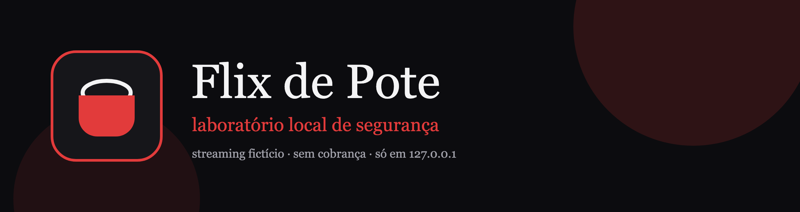

<p align="center">
  
</p>

Streaming fictício para treinar segurança de aplicações web na sua própria máquina. O catálogo, as contas, os cupons e o checkout são inventados. Não há serviço real, gateway de pagamento nem cobrança.

## O que é

O Flix de Pote imita uma plataforma de filmes para que seja possível observar, com calma, falhas comuns de autorização e de lógica. Tudo roda em Node.js, com SQLite embutido e uma interface própria. Os filmes, os pôsteres e os nomes são originais.

O `npm start` sobe o modo seguro: as quatro falhas de laboratório ficam desligadas e o servidor escuta apenas em `127.0.0.1`. Cada exercício liga com uma variável de ambiente, de forma independente.

## Aviso

Este projeto contém vulnerabilidades **intencionais**, e só quando o exercício correspondente está ligado. Use somente em localhost, com os dados descartáveis do laboratório. Não exponha a porta para a rede, não use contas reais e não trate o checkout como pagamento. O botão **Restaurar dados** devolve o banco ao início e encerra a sessão.

## Desafios

Nenhum modo abaixo vem ativo no `npm start`. A ideia é investigar o comportamento com o exercício ligado e comparar com o modo seguro.

| Exercício | Como ligar | O que observar |
| --- | --- | --- |
| Mass Assignment | `npm run start:mass-assignment` | O que a atualização de perfil aceita, além do nome. |
| Match & Replace | `npm run start:match-replace` | Como a interface decide o que parece liberado. |
| Excessive Data Exposure | `npm run start:excessive-data` | O que a resposta do catálogo carrega e a tela não mostra. |
| Race Condition | `npm run start:race-condition` | O cupom de um único resgate diante de pedidos simultâneos. |

Há também uma flag bônus, no formato `FLAG{...}`, escondida no laboratório. Ela não depende dos quatro exercícios. Quem encontrar pode enviá-la no Perfil, no campo **Código da sessão**. **Restaurar dados** sorteia outra flag.

## Requisitos

- Node.js 22.5 ou mais recente. O SQLite já vem no Node.
- Navegador moderno.
- Nada de banco externo, chave de API ou conta na nuvem.

## Instalação

```bash
npm install
npm start
```

Abra http://127.0.0.1:3000.

Os dados ficam em `data/flix.db`, que não entra no Git. Para os testes automáticos:

```bash
npm test
```

## Contas de teste

| Conta | E-mail | Senha | Plano inicial |
| --- | --- | --- | --- |
| Maria Costa | maria.costa@pote.local | pipoca | Free |
| João Lima | joao.lima@pote.local | pipoca | Pote Família |

| Plano | Preço fictício |
| --- | --- |
| Free | R$ 0,00/mês |
| Pote Solo | R$ 18,90/mês |
| Pote Família | R$ 29,90/mês |
| Pote Ostentação | R$ 44,90/mês |

Os planos pagos liberam a coleção Premium. A troca acontece pelo checkout de teste, com o cartão fictício mostrado na própria página. O número não é armazenado e nada é cobrado.

Cupons de exemplo: `POTEBEMVINDO` e `NOITEDECINEMA`.

## Vídeo

O passo a passo em vídeo sai no canal **Douglas Lockshield**.

**https://youtu.be/iH16u6cqvp4**

## Licença

[MIT](LICENSE). O código, a interface, os textos e as imagens deste repositório são originais. A dependência de execução é o Express, também sob MIT.
